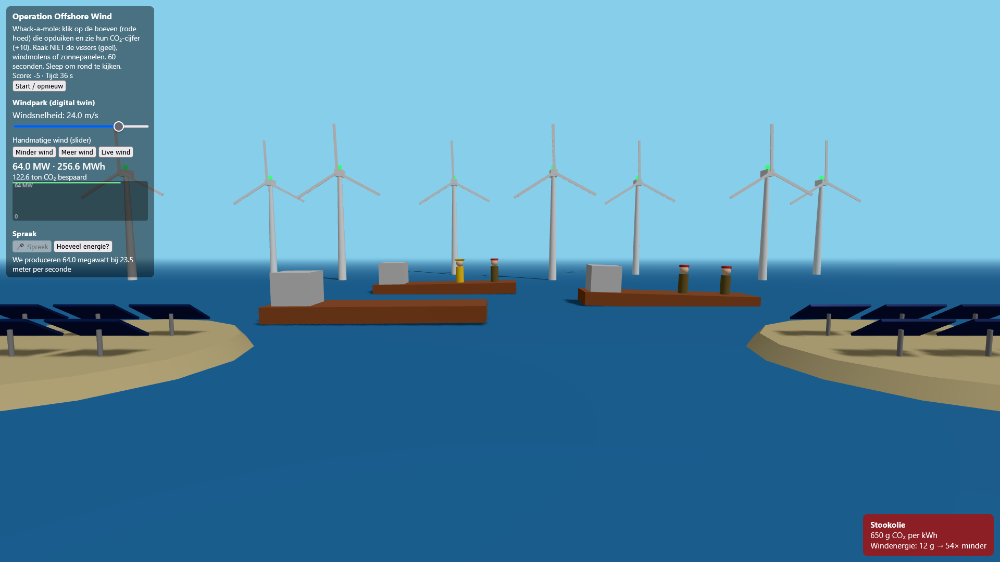
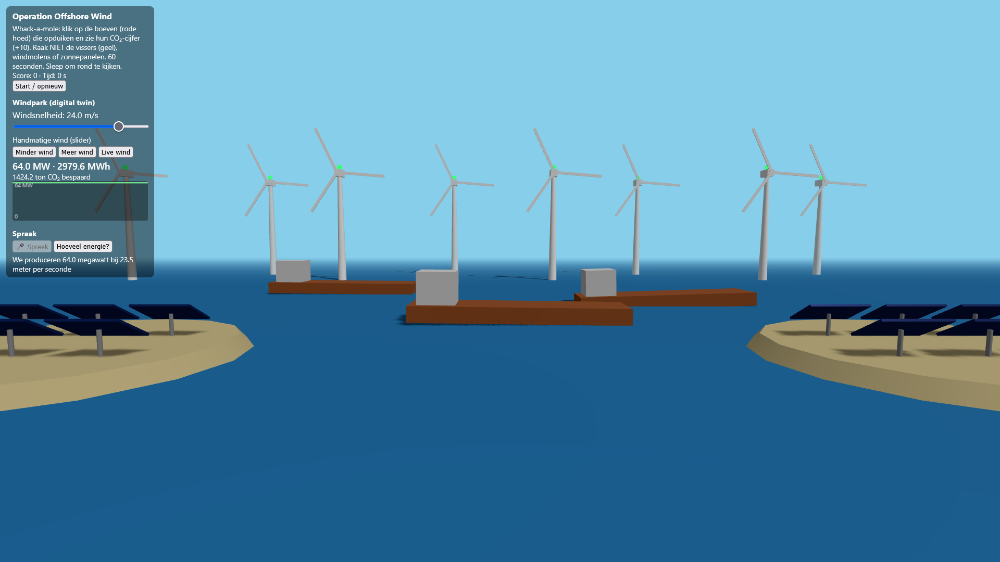
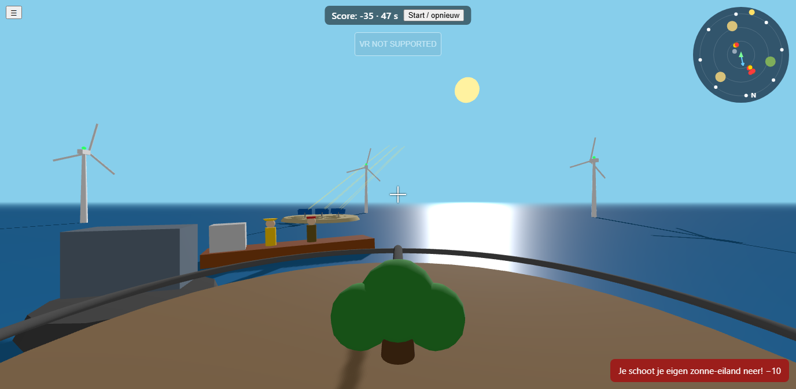

# Energy Twin – Operation Offshore Wind

Een digital twin in 3D (Three.js + Vite, gewone JavaScript, geen framework): een offshore windpark met zonne-eilanden, een dorp en een batterij, bediend vanaf een boom-kanon in het midden dat bladeren schiet naar vervuilende "boeven" op boten.

**Live:** https://lukas-bohez.github.io/future-technologies/

**Fase 1 (de losse, kale scène):** [../Phase-1/README.md](../Phase-1/README.md) · https://lukas-bohez.github.io/future-technologies/phase-1/

**Leren en uitleggen:** zie [../LEREN.md](../LEREN.md) (uitleg per bestand, de berekeningen, verwachte vragen, oefeningen en demo-script).

## Starten

```bash
cd "week 2/energy-twin"
npm install
npm run dev      # dev-server op http://localhost:5173
npm run build    # productiebuild in dist/
npm run preview  # build lokaal bekijken
```

Vereist Node 18+ (getest met Node 24). Aanbevolen browser: Chrome of Edge (spraak, Web Serial en WebXR werken daar).

## Bediening

| Toets | Actie |
| --- | --- |
| ← → | boom (en camera) draaien, 360° |
| ↑ ↓ | omhoog/omlaag kijken en richten |
| Spatiebalk | blad afschieten |
| H | paneel tonen/verbergen |

- De camera zit **vast** aan de boom: geen vrije camerabeweging. Op aanraakschermen zijn er knoppen.
- **Alles staat in cirkels rond je**: batterij (8 m), drie ringen boten (12, 17, 22 m), eilanden (33 m) en een ring van 8 windmolens (45 m). De **radar** rechtsboven toont dat bovenaanzicht met jouw kijkrichting naar boven (N = noord, blauwe pijl = windrichting, geel bolletje = zon, rode stippen = boeven, gele stippen = vissers).
- Het **kruisje** kleurt groen boven een boef en rood boven iets dat je niet mag raken. Er is een **richthulp** (±5°) en royale hitboxes.
- Een blad **stopt bij het eerste ding op zijn pad**: boef, romp of stuurhut, eiland, molen of zee. Schoten doorboren niets.
- Punten: boef +10 (met zijn CO₂-cijfer), visser −15, windmolen/zonne-eiland/dorp/batterij −10. Ronde van 60 s, hoe verder in de ronde hoe korter de boeven zichtbaar blijven.

## Wat zit erin (opdracht)

| Onderdeel | Waar |
| --- | --- |
| **Thema's: windenergie én zonne-energie** | windpark met richting en snelheid; zon door dag en seizoen met stralen, schaduw en kWh |
| Fase 1: scène, ≥4 objecten, licht, interactie, beweging | `world.js`, `game.js`, `turret.js` |
| Fase 2: echte data | Open-Meteo (wind, richting, bewolking) en SunCalc (zonnestand), `data.js`, `solar.js` |
| Fase 3A: spraak | `voice.js`: ≥3 commando's, verstane zin + gevolg getoond, knoppen als terugval |
| Fase 3B: simulatie met zichtbaar effect | `wind.js`, `solar.js`, `grid.js`: live waarden, grafieken, kleur/licht/stralen, regelbare parameters |
| **Uitbreiding 1: twee scenario's vergelijken** | paneel "Scenario's vergelijken": zuid vs oost-west, en met vs zonder batterij |
| **Uitbreiding 2: geld én CO₂-besparing** | paneel "Net, batterij en geld" |
| **Uitbreiding 3: echte hardware/sensor** | paneel "Hardware en VR": Web Serial (ESP32/Arduino) of gesimuleerde sensor |
| **Uitbreiding 4: zonnestralen en schaduw** | shadow map die met de zon meebeweegt, gele stralen van de zon naar elk paneel |
| **Uitbreiding 5: AI-assistent op actuele waarden** | paneel "Assistent" (lokaal, of Claude met eigen sleutel) |
| **Uitbreiding 6: meerdere bronnen vormen een net** | wind + zon + batterij voeden een dorp met verbruiksprofiel; import/export |
| **Uitbreiding 7: WebXR** | VR-knop, de kanon werkt met de controller-trekker |

### Wind (windrichting én -snelheid bepalen draaisnelheid en opbrengst)
- **Windsnelheid** en **windrichting** via sliders, knoppen, spraak, "Live wind" of de sensor.
- Elke turbine draait zich met beperkte snelheid naar de wind. Staat hij scheef (hoek err), dan vangt hij maar `wind · cos(err)` op: bij een draaiing van de wind zakt de opbrengst even en herstelt dan.
- Wieken draaien volgens de opgevangen wind, het lampje gaat van rood naar groen.

### Zon (dag, seizoen, stralen, schaduw, kWh)
- **Uur** en **datum**: de zon staat op de echte positie (SunCalc) voor de Belgische kust. Licht, schaduwen, luchtkleur en de stralen volgen. 's Nachts is het donker en gaan de lichtjes in het dorp feller branden.
- **Paneelhoek** en **opstelling** (zuid of oost-west, helft oost en helft west) zijn regelbaar.
- "Pauze/Speel af": de dag speelt versneld af (1 s = 10 gesimuleerde minuten). De **dagcurve** toont de productie van de gekozen datum.

### Net, batterij en geld
- Het verbruiksprofiel van een regio (laag 's nachts, pieken om 8u en 19u, 35 MW rond de avondpiek) wordt gedekt door wind + zon. Overschot laadt de **batterij** (80 MWh, 25 MW, 90% rendement) of wordt **geëxporteerd**; een tekort komt uit de batterij of wordt **geïmporteerd**. De vulbalk van het batterijstation en het licht in het dorp tonen dit in de scène.
- **Geld**: besparing op zelf gebruikte stroom, export-opbrengst (de helft van de prijs) en importkosten, met een regelbare stroomprijs. Daarnaast de **CO₂-besparing** (en de waarde ervan bij €70/ton).

### Scenario's vergelijken
Voor de gekozen datum, paneelhoek, bewolking en huidige wind worden volledige dagen gesimuleerd (2 dagen na elkaar, de tweede telt, zodat de batterij niet gratis begint):
- **A. Zuid vs oost-west** (oost-west met max. 15° helling): zonne-energie, piekvermogen, import, export, zelfvoorzienend % en netto €/dag, met een grafiek van beide dagcurves.
- **B. Zonder vs met batterij**: hoeveel import de batterij uitspaart.

### Assistent
Vraag bv. "waarom is de opbrengst laag?", "wat is de batterijlading?", "hoeveel geld besparen we?", "welk scenario is beter?" of "geef me een tip". Standaard beantwoordt een **lokale, regelgebaseerde** assistent de vragen met de actuele waarden (geen cloud). Optioneel kan je een eigen **Claude API-sleutel** invullen: dan gaan de vraag en de actuele waarden (JSON) naar api.anthropic.com. De sleutel blijft alleen in het geheugen van de pagina. Zinnen die geen commando zijn, gaat de spraakknop automatisch naar de assistent.

### Hardware
Koppel een ESP32/Arduino met een windsensor via USB (Web Serial, Chrome/Edge) of klik "Simuleer sensor". De microcontroller stuurt regels zoals `{"wind": 7.5, "dir": 220}` of `wind=7.5 dir=220` (115200 baud). Een voorbeeldprogramma staat in [../hardware/esp32-wind-sensor/](../hardware/esp32-wind-sensor/esp32-wind-sensor.ino) (potmeters als windsnelheid en -richting). Zodra de sensor data stuurt, bepaalt die de wind in de scène.

### Spraak (Chrome of Edge, knop "Spreek")
"meer wind", "minder wind", "zet de wind op 12", "wind uit het zuidwesten", "windrichting op 90 graden",
"zet de zon op 15 uur", "zet de zon op de zomer", "pauzeer"/"speel af", "batterij aan/uit",
"zet de panelen oost-west", "vergelijk de scenario's", "hoeveel energie produceren we", "hoeveel zonne-energie",
"hoeveel geld besparen we", "hoeveel CO2 bespaard", "live wind", "opnieuw". De verstane zin en het gevolg staan in het paneel; voor de meeste commando's zijn er ook sliders of knoppen.

## Code-overzicht

| Bestand | Rol |
| --- | --- |
| `src/main.js` | Koppelt alles: HUD, windbron (slider/live/sensor), assistent, scenario's, render loop, VR |
| `src/world.js` | De 3D-wereld: zee, licht, windmolens, zonne-eilanden, dorp, batterij; alles in cirkels (`ringPosition`) |
| `src/game.js` | Boten in banen, personages (toestandsmachine per slot), botsingen (`findHit`), score |
| `src/turret.js` | De boom-kanon: richten, schieten, bladeren en spoor, richthulp |
| `src/radar.js` | Radar (bovenaanzicht rond de speler) |
| `src/wind.js` | Windformules (pure functies) |
| `src/solar.js` | Zonnestand (SunCalc), straling en zonnevermogen |
| `src/grid.js` | Net, batterij, geld en dagsimulatie voor scenario's |
| `src/data.js` | Open-Meteo ophalen |
| `src/hardware.js` | Web Serial en gesimuleerde sensor, parser voor sensorregels |
| `src/assistant.js` | Lokale assistent en optionele Claude-aanroep |
| `src/voice.js` | Commando's herkennen (Web Speech API) en antwoorden uitspreken |
| `src/chart.js` | Lopende grafiek en dagcurve op een 2D-canvas |
| `vite.config.js` | `base: './'` zodat de build op GitHub Pages werkt |

## Hoe de basis werkt (Three.js)

1. `Scene` bevat alle objecten. Een object = `Mesh(geometry, material)`, toegevoegd met `scene.add(...)`. Een `Group` is een mapje van meshes die samen bewegen.
2. `PerspectiveCamera` + `WebGLRenderer` tekenen de scène. De camera zit hier als kind in de draaiende boom-kanon, dus draait mee.
3. `renderer.setAnimationLoop(animate)` draait elk frame (ook in VR). `dt` (seconden sinds vorig frame) maakt beweging onafhankelijk van de framerate.
4. Schaduw: `renderer.shadowMap.enabled`, op het licht `castShadow = true`, op meshes `castShadow`/`receiveShadow`. De zon is een `DirectionalLight` waarvan de positie elk frame uit SunCalc komt.
5. Een kogel is een bewegend punt dat in kleine stapjes vooruit gaat en elke stap `findHit` aanroept; zo kan een snel blad niet dwars door iets vliegen.

## Deploy (GitHub Pages)

Workflow: [.github/workflows/deploy-energy-twin.yml](../../.github/workflows/deploy-energy-twin.yml).
Eenmalig instellen: GitHub repo → Settings → Pages → Source = **GitHub Actions**. Daarna publiceert elke push naar `main` die `week 2/energy-twin/` raakt automatisch.

## Bronnen en formules

- **Wind en bewolking**: Open-Meteo (https://open-meteo.com), `wind_speed_100m`, `wind_direction_100m` (waar de wind *vandaan* komt) en `cloud_cover`.
- **Vermogen per turbine** (MW), met effectieve wind `v = wind · cos(err)`: 0 onder cut-in (3 m/s); `P = Pn · (v³ − 3³) / (12³ − 3³)` tot nominaal (12 m/s); `Pn = 8 MW` tot cut-out (25 m/s); daarboven 0. Park = 8 turbines = 64 MW.
- **Zonnestand**: SunCalc (https://github.com/mourner/suncalc), locatie 51.2°N 2.9°E, tijd in UTC+1 (zomertijd genegeerd).
- **Straling bij heldere hemel**: `I = 1353 · 0,7^(AM^0,678)` W/m² met `AM = 1 / sin(hoogte)` (Meinel). Bewolking: `factor = 1 − 0,75 · (bewolking)^3,4` (Kasten-Czeplak). Handmatig = onbewolkt, live gebruikt de echte bewolking.
- **Zonnevermogen**: `P = aantal panelen · 25 000 m² · 20 % · I · cos(hoek zon-paneel)`. Elk paneeltje in de scène stelt een veld van 2,5 ha voor; 12 paneeltjes = 30 ha = 60 MW piek. Paneelnormaal: `(sin(yaw)·sin(tilt), cos(tilt), cos(yaw)·sin(tilt))`, yaw 0 = zuid, ±90° = oost/west.
- **Net**: verbruik `35 MW · (0,62 + 0,28·piek(8u) + 0,38·piek(19u))`. Batterij 80 MWh, 25 MW, 90% rendement heen en terug (√0,9 per richting).
- **Geld**: besparing = zelf gebruikte MWh × prijs; export = MWh × prijs × 0,5; import = MWh × prijs. CO₂-waarde €70/ton (aanname).
- **Energie**: `E += P · Δt` met gesimuleerde tijd Δt.
- **CO₂-besparing**: tegenover aardgas (490 g/kWh): wind 12 g/kWh, zon 41 g/kWh.
- **CO₂-cijfers van de boeven**: levenscyclus-mediaan, IPCC AR5 (2014), bijlage III: steenkool 820, stookolie ~650, aardgas 490, biomassa 230 g/kWh. Afgerond.
- **Grootste vereenvoudigingen**: geen windschaduw tussen turbines, vaste luchtdichtheid, geen netverliezen, benaderde vermogenscurve i.p.v. de fabrikantcurve; bij zon alleen directe straling (geen diffuus licht); een verbruiksprofiel en prijzen die aannames zijn, geen echte data; scenario's rekenen met constante wind over de dag.

## Privacy

- **Spraak**: de Web Speech API van Chrome/Edge stuurt de audio naar de cloud van de browserleverancier voor herkenning. Wij slaan niets op. Antwoorden worden lokaal uitgesproken (speechSynthesis).
- **Data**: alleen de vaste coördinaten van de locatie gaan naar api.open-meteo.com (bij "Live wind"). SunCalc rekent lokaal. Geen accounts, geen cookies, geen tracking.
- **Assistent**: standaard volledig lokaal. Alleen als je zelf een Claude API-sleutel invult, gaan je vraag en de actuele waarden naar api.anthropic.com; de sleutel wordt niet bewaard.
- **Hardware**: sensordata blijft in de browser (Web Serial, de gebruiker kiest zelf het apparaat).
- Geen 3D-scans gebruikt, dus geen personen of privéspullen.

## Wat is getest en wat niet

Getest in een headless Edge: laden zonder fouten, schieten met toetsen, treffers en punten, scenario-tabel, assistent (lokaal), gesimuleerde sensor, en de rekenfuncties met een Node-script (windcurve, zonnestand, net/batterij, spraakcommando's, sensorparser).
**Niet getest**: een echte VR-headset (WebXR), een echte ESP32 over Web Serial (de parser wel), en de Claude-aanroep van de assistent (geen sleutel gebruikt).

## AI-verantwoording (fase 2 en 3 en uitbreidingen)

Tool: Claude Code (Claude Sonnet 5.5).

- **Fase 1:** De losse, kale fase 1-scène staat in [`week 2/Phase-1/`](../Phase-1/README.md): dat is een herbouw van dezelfde opdracht in één bestand, met lichte AI-hulp, bedoeld om de basis (scène, licht, klikken, render loop) rustig te kunnen uitleggen en om alles te kunnen leren.
- **Fase 2 en 3:** `wind.js`, `data.js`, `voice.js`, `chart.js` en de koppeling in `main.js` zijn door de AI geschreven op basis van de opdracht, plus de uitbreiding tot whack-a-mole (meer boten, vissers, zonnepanelen).
- **Herbouw en uitbreidingen:** de cirkelopstelling, de vaste camera op de boom-kanon, de radar, `grid.js`, `hardware.js`, `assistant.js`, de WebXR-koppeling en het scenario-paneel zijn door de AI geschreven.

### Prompts (samengevat, in mijn eigen woorden zoals ik ze gaf)

1. Opdracht en lesmateriaal geplakt: "zet alles klaar zodat ik kan beginnen, documenteer hoe het werkt, push naar GitHub, kies het beste framework" (resultaat: Vite + vanilla Three.js, README, GitHub Pages-workflow).
2. In de code zette ik zelf een boot en de opmerking dat ik wil schieten op slechte kerels op een boot, "zoals 007 maar simpel, met statistieken die verschijnen, make it make sense" (resultaat: offshore windpark met boeven die een CO₂-cijfer tonen).
3. "Doe fase 2 en 3, en push" (resultaat: Open-Meteo live wind, spraakcommando's, windsimulatie, grafiek, lampjes, CO₂-besparing).
4. Bugs/wensen: "enemies respawnen niet", "2 keer meer wind" (resultaat: respawn na 3 s en wieken 2× sneller).
5. "Maak het zoals whack-a-mole met dingen die je niet mag raken, meer boten, meer windmolens, ook zonnepanelen" (resultaat: rondes van 60 s, vissers en schone installaties met strafpunten).
6. Opmerking dat windrichting ontbrak en dat we de thema's zonne-energie én windenergie doen (uit de opdracht geplakt), "zorg dat je me niet voor schut zet" (resultaat: windrichting met opbrengst via cos(fout), zon via SunCalc met dag/seizoen, stralen, schaduw, paneelhoek, kWh en dagcurve).
7. "Doe iets met de boom die ik gegeven heb: pijltjestoetsen bewegen de boom links en rechts, je schiet bladeren naar de slechterikken met de kogelschot als bullet trail van bladeren, een boom in de vorm van een geweer" (resultaat: boom-kanon, schieten met de spatiebalk, bladerenspoor, botsingsdetectie per stapje).
8. "Camerabeweging uitzetten, volledig geanchored op de tree turret, op en neer kijken en links en rechts draaien, makkelijker maken, shots penetreren niet meer, alles in een cirkel rond de speler, denk het professioneel uit" en "werk alle uitbreidingen uit" (de zeven uitbreidingen uit de opdracht geplakt) (resultaat: vaste camera op de kanon, 360°-wereld met radar, richthulp, kogels die stoppen bij het eerste ding, scenario's, geld, hardware, zonnestralen/schaduw, assistent, net met batterij, WebXR).

### Wat ik controleerde en aanpaste

- Zelf toegevoegd: de boom op de pier, en de keuze van thema en spelidee.
- Formules en eenheden nagelezen: vermogen ~ v³ tussen 3 en 12 m/s, nominaal 8 MW per turbine, uitschakeling vanaf 25 m/s; MW × uur = MWh; CO₂ in g/kWh → ton. De CO₂-cijfers komen uit IPCC AR5 (afgerond). Aannames (verbruik, prijzen, schaal van de zonnevelden) zijn in deze README benoemd.
- Het resultaat getest in de browser (zie "Wat is getest en wat niet").

## Demo (screenshots)





## Reflectie

Het was moeilijk om te leren, maar met de hulp van Claude heb ik veel bijgeleerd over hoe ik met Three.js moet werken en 3D-objecten moet maken. Jammer genoeg heeft de AI iets te veel gedaan, waardoor er weinig voor mij overbleef om zelf te doen. Het belangrijkste is voor mij dat ik veel heb geleerd, zoals hoe lighting, 3D-objecten en de camera gemaakt worden in gewone HTML, CSS en JavaScript, zonder framework. Dat is volgens mij het belangrijkste wat je hieruit kan halen: dat je er iets uit leert.
Ik vondt het wel leerrijk om Phase 1 zelf te maken: de basis is manueel geschreven, met lichte AI-hulp (chatberichten om slecht gedocumenteerde dingen duidelijker te maken).
